<!--
  Styled after my portfolio, https://shivam-k.vercel.app.
  The images in assets/ are generated by scripts/build.py: edit the content there and rebuild.
-->

<a href="https://shivam-k.vercel.app"></a>

  <a href="https://shivam-k.vercel.app"></a>&nbsp;
  <a href="https://shivam-k.vercel.app/shivam_kumar_resume.pdf"></a>&nbsp;
  <a href="https://linkedin.com/in/shivam-kumar-434437239"></a>&nbsp;
  <a href="https://leetcode.com/shiv40"></a>&nbsp;
  <a href="mailto:shivamkumar404090@gmail.com"></a>

 

<a href="https://shivam-k.vercel.app/#experience"></a>

  

<a href="https://shivam-k.vercel.app/#projects"></a>

<samp>
  <b>fintraqq</b> <a href="https://fintraqq.vercel.app">↗ live demo</a>
  &nbsp;·&nbsp; <b>algosphere</b> <a href="https://algosphere-client.vercel.app">↗ live demo</a> <a href="https://github.com/shiv4006/algosphere-frontend">&lt;/&gt; source</a>
   
  <b>pizzahub</b> <a href="https://github.com/shiv4006/pizza-hub">&lt;/&gt; source</a>
  &nbsp;·&nbsp; <b>mutual-transfer</b> <a href="https://mutual-transfer-client.vercel.app">↗ live demo</a> <a href="https://github.com/shiv4006/mutual-transfer">&lt;/&gt; source</a>
</samp>

  

<a href="https://shivam-k.vercel.app/#skills"></a>

  

<a href="https://shivam-k.vercel.app/#achievements"></a>

  

<a href="https://shivam-k.vercel.app/#coding-profiles"></a>

<samp>
  ↗ <a href="https://leetcode.com/shiv40">leetcode</a>
  &nbsp;·&nbsp; ↗ <a href="https://www.codechef.com/users/shiv75">codechef</a>
  &nbsp;·&nbsp; ↗ <a href="https://codeforces.com/profile/shiv40">codeforces</a>
  &nbsp;·&nbsp; ↗ <a href="https://www.hackerrank.com/profile/shiv_19">hackerrank</a>
  &nbsp;·&nbsp; ↗ <a href="https://www.geeksforgeeks.org/user/shivamkum5qj0/">geeksforgeeks</a>
  &nbsp;·&nbsp; ↗ <a href="https://www.naukri.com/code360/profile/nShiv">code360</a>
</samp>

  


  
  

<picture>
  <source media="(prefers-color-scheme: dark)" srcset="https://raw.githubusercontent.com/shiv4006/shiv4006/output/snake-dark.svg">
  
</picture>

  

<a href="mailto:shivamkumar404090@gmail.com"></a>

